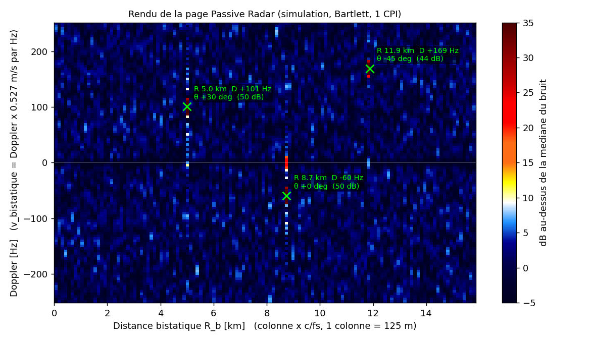
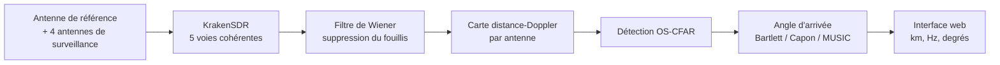
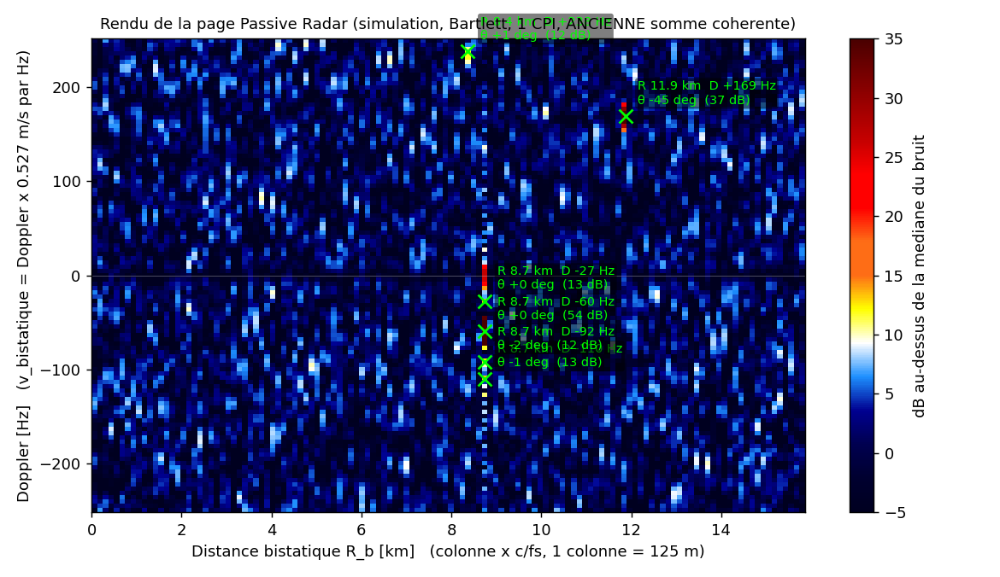
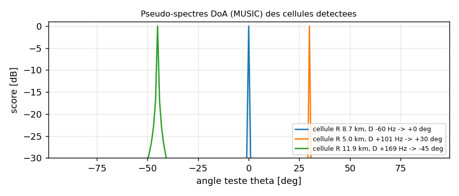
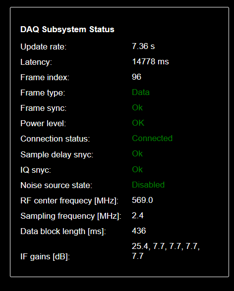

# Radar passif multicanal sur KrakenSDR

Un radar qui n'émet rien : il écoute un émetteur de télévision (DVB-T, 569 MHz) et détecte les échos que ce signal renvoie sur les avions. Récepteur cohérent à 5 voies, une antenne de référence et 4 antennes de surveillance, traitement sur Raspberry Pi 5.

*Carte distance-Doppler en simulation : trois cibles, 50 à 56 dB sous le trajet direct, retrouvées en distance, en vitesse et en angle.*

| | |
|---|---|
| Cadre | projet personnel, 2025 à 2026 |
| Matériel | KrakenSDR (5 tuners RTL-SDR cohérents), Raspberry Pi 5, antenne Yagi UHF, 4 antennes fouet |
| Logiciel | Python, NumPy, Numba, pyFFTW, Dash ; base : radar passif open source de KrakenRF (2 voies) |
| Code | privé, disponible sur demande |

## Le principe

L'antenne de référence, pointée vers l'émetteur, reçoit le signal TV presque pur. Les 4 antennes de surveillance reçoivent ce même signal, plus des échos très faibles renvoyés par les cibles, retardés (distance) et décalés en fréquence (vitesse). Pour chaque bloc de 0,44 s :

1. **Suppression du fouillis** par filtre de Wiener : on retire tout ce qui se prédit depuis la référence (trajet direct, bâtiments).
2. **Carte distance-Doppler** par corrélation croisée : 2^20 échantillons intégrés, soit 60 dB de gain, ce qui fait sortir un écho enfoui sous le bruit.
3. **Détection OS-CFAR** : un seuil adaptatif, cellule par cellule, à taux de fausse alarme fixé.
4. **Direction d'arrivée** : les écarts de phase entre les 4 antennes donnent l'angle de chaque écho (Bartlett, Capon ou MUSIC).

## Ce que j'ai fait

Le radar de KrakenRF ne gère que 2 voies et ne donne pas d'angle. Je l'ai étendu à 5 voies, avec détection automatique et estimation de direction, puis audité et corrigé :

- **somme des antennes** : la version initiale additionnait les cartes de façon cohérente, ce qui revient à un faisceau pointé droit devant. Une cible à 30° devenait invisible. Remplacée par une somme incohérente, indépendante de l'angle ;
- **seuil de détection** : la formule utilisée donnait un seuil 11 dB trop haut (probabilité de fausse alarme réelle de 10^-49 au lieu de 10^-5). Recalculée pour une amplitude de Rayleigh ;
- **direction d'arrivée** : Capon appliqué à un seul instantané se réduit à Bartlett. La matrice de covariance est maintenant estimée sur plusieurs blocs et cellules voisines, avec choix de la méthode ;
- simulateur hors ligne, tests automatisés et installation sur Raspberry Pi 5.

L'audit et une partie du code ont été faits avec l'aide d'un assistant IA ; la mise en œuvre et la validation sur le matériel sont les miennes.

## Résultats

**En simulation** (3 cibles à +30°, 0° et -45°, 4 antennes espacées d'une demi-longueur d'onde) :

| Cible | Attendu | Mesuré |
|---|---|---|
| 1 | 5,00 km, +100 Hz, +30° | 5,00 km, +100,7 Hz, +30,0° |
| 2 | 8,74 km, -60 Hz, 0° | 8,74 km, -59,5 Hz, 0,0° |
| 3 | 11,87 km, +170 Hz, -45° | 11,87 km, +169,4 Hz, -45,0° |

Aucune fausse alarme sur 57 000 cellules.

Avec l'ancienne somme des antennes, sur la même scène, la cible à +30° disparaît et trois fausses détections apparaissent :

Avec MUSIC, les pics de direction font moins de 2° de large :

**Sur le matériel** : les 5 voies sont synchronisées et calibrées en phase sur le Raspberry Pi 5.

## Pour aller plus loin

- [Rapport technique, 3 pages](docs/rapport_technique.pdf)
- [Les mathématiques du radar et leur correspondance avec le code](docs/maths_et_code.pdf)
- [De la phase à l'angle d'arrivée, pas à pas](docs/direction_par_la_phase.pdf)

## Limites

- Réseau linéaire : ambiguïté avant/arrière, précision dégradée vers ±90°.
- Pas encore de position au sol (croisement de l'ellipse de distance et de la direction) ni de pistage d'un bloc à l'autre.
- Signe de l'angle à confirmer sur une cible réelle, recoupée avec les positions ADS-B.

---

Yanis Djelali, élève ingénieur en télécommunications, ENSEIRB-MATMECA. Radioamateur F4NJF.
