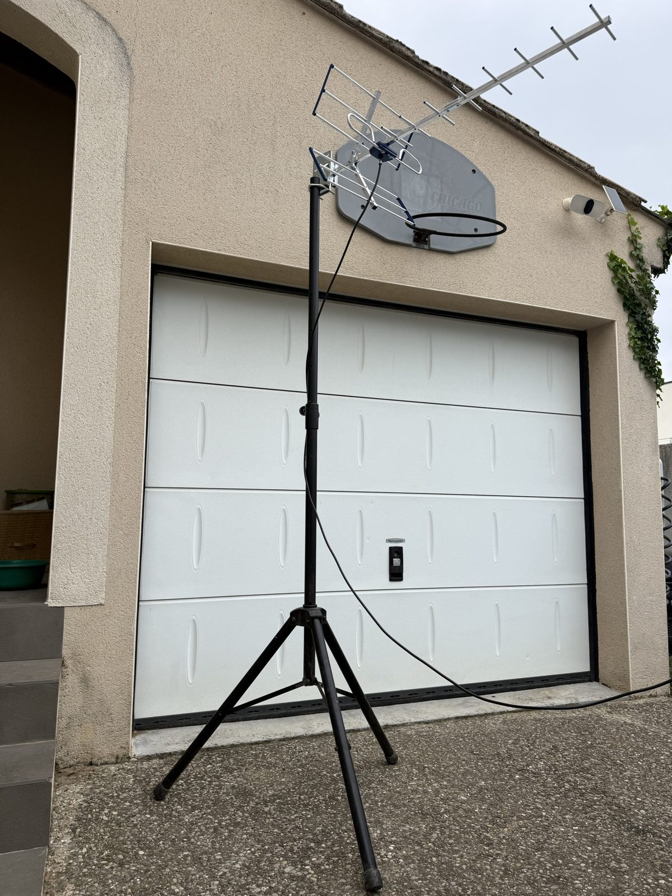
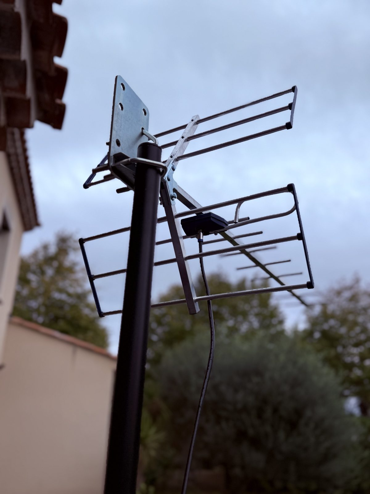
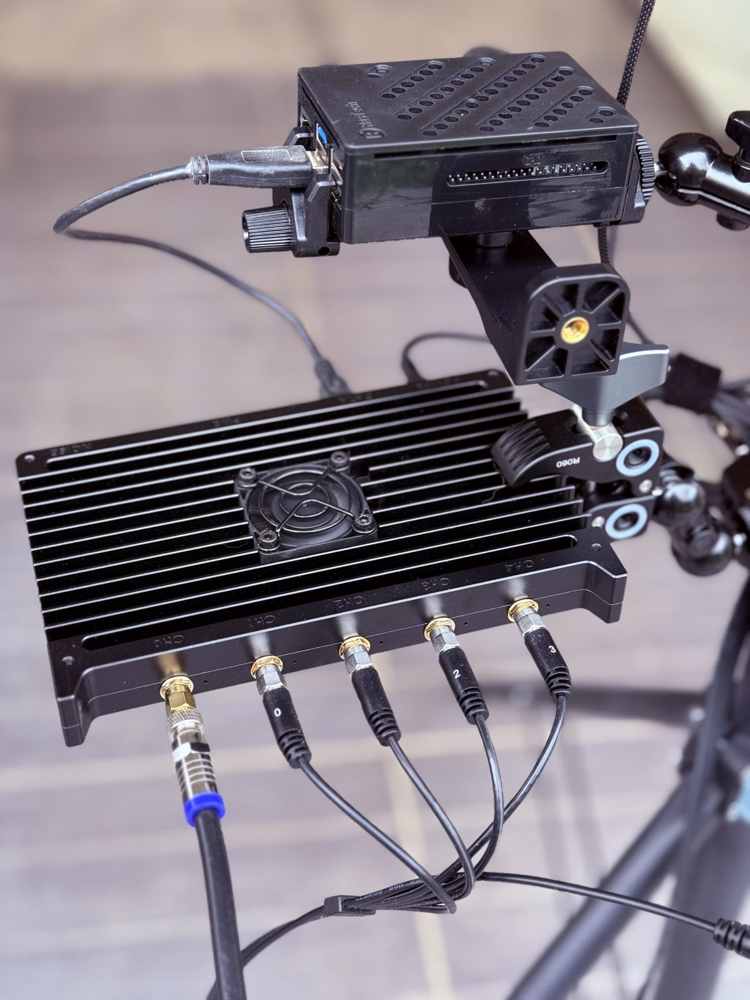
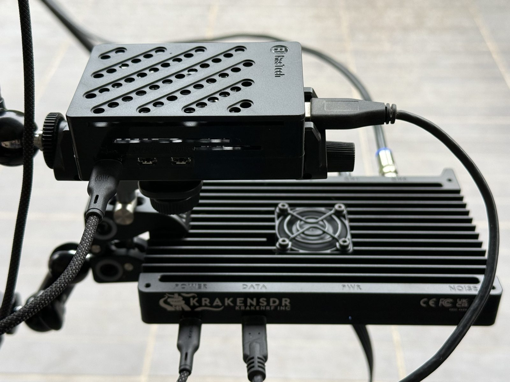
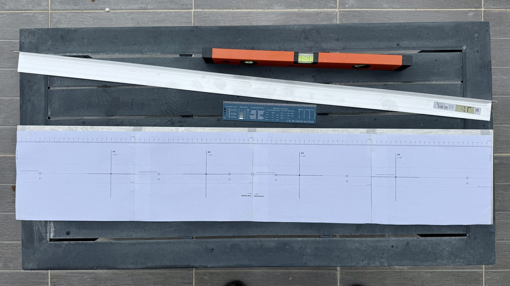
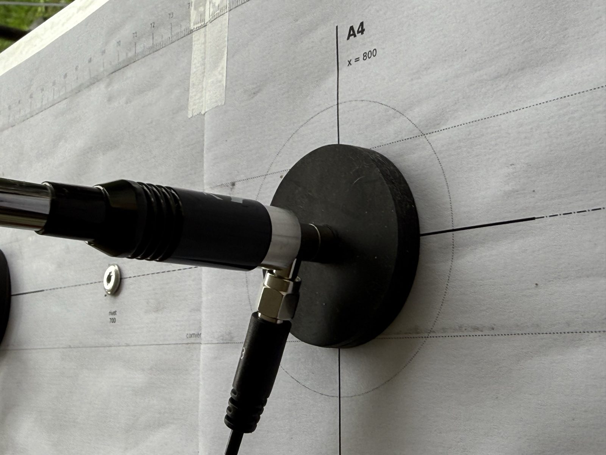
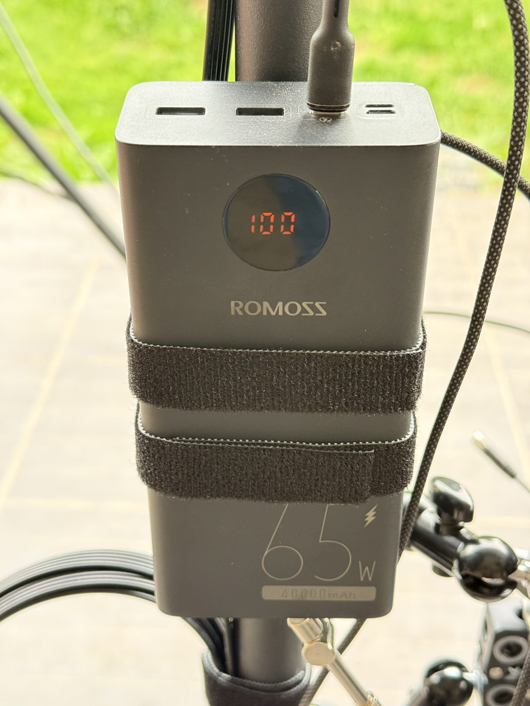

# Photos du montage

[Retour au projet](../../README.md)

| | |
|---|---|
|  |  |
| Le mât sur son pied, antenne Yagi en haut. | Antennes directives en haut du mât. |
|  |  |
| KrakenSDR (5 voies cohérentes) et Raspberry Pi 5 sur leur support. | Vue de dessus du KrakenSDR et du Raspberry Pi 5. |
|  |  |
| Gabarit imprimé à l'échelle, vérifié au niveau et au mètre. | Une antenne posée sur sa marque (A4). |
|  | |
| Batterie 65 W qui alimente l'ensemble. | |
